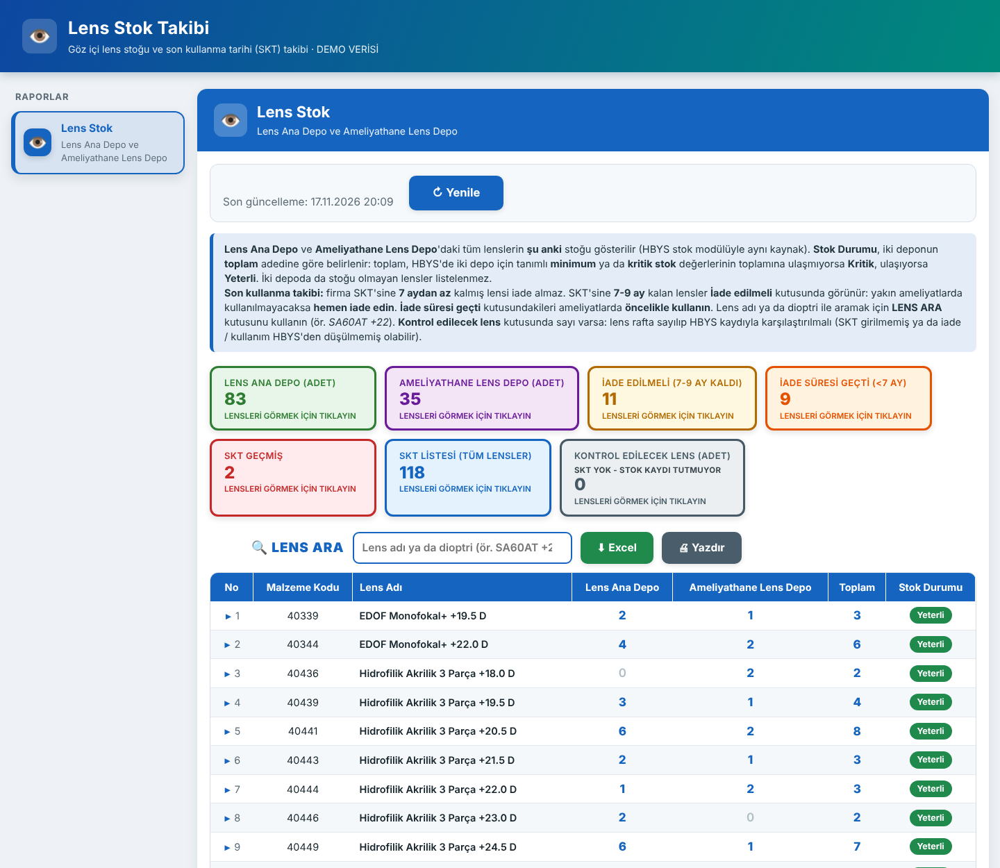

# 👁️ Lens Stock & Expiry Tracker

**Never let an intraocular lens expire on the shelf again.**

A web dashboard for eye hospitals that shows **intraocular lens (IOL) stock** across two depots in real time, warns when stock is critical, and tracks every lens's **expiry date** so it can be returned to the supplier while the supplier will still accept it.

Built and used in a private eye hospital, then open-sourced with all institutional data removed.



> 🇹🇷 Arayüz Türkçedir. Ekrandaki tüm veriler **demo verisidir**.

---

## The problem

Intraocular lenses are expensive, come in dozens of models and diopters, and expire. Suppliers usually won't take back a lens with **less than 7 months** of shelf life left. Without a clear view, lenses quietly pass the return window and become waste.

## What it does

| Feature | Details |
|---|---|
| **Live stock, two depots** | Main lens depot and operating-room depot side by side, one row per lens |
| **Critical stock alert** | Compares total stock with the minimum / critical levels defined in the HBYS |
| **Return window (7–9 months)** | Lenses that should be returned **now** if they won't be used in upcoming surgeries |
| **Return window passed (< 7 months)** | Lenses to **use first** in surgeries |
| **Expired** | Lenses past their expiry date |
| **Serial-level detail** | Click a lens to see every unit: depot, serial number, expiry, days left |
| **Data quality check** | Flags lenses whose stock doesn't match their serial-number records, so they can be counted on the shelf |
| **Search** | By model or diopter (e.g. `+22`) |
| **Excel & print** | Every list can be exported |

Each lens unit is traced **by serial number / barcode** through stock movements, the same logic as the HBYS "show barcodes" screen.

## Security & privacy

- **Read-only.** The app only runs `SELECT` queries. Use a dedicated read-only database user.
- **Access control.** Optional IP allowlist and HTTP Basic login.
- **No data leaks.** Database errors are logged on the server only; the browser gets a generic message.
- **No secrets in the repo.** Credentials live in `config.ini`, which is git-ignored.

## Quick start

**Try it without a database (demo data):**
```bash
pip install -r requirements.txt
DEMO=1 python app.py            # Windows: set DEMO=1 && python app.py
```
Open `http://localhost:5052`.

**With your HBYS (Oracle):**
1. Copy `config.ini.ornek` to `config.ini` and fill in the database details.
2. Set your depot numbers (`LENS_ANA_DEPO`, `LENS_AMELIYATHANE_DEPO`) and return thresholds (`IADE_UYARI_AY`, `IADE_SON_AY`) at the top of `raporlar.py`.
3. On Windows: run `kurulum.bat` as administrator once, then `baslat.bat`.

## Tech stack

`Python` · `Flask` · `python-oracledb` · `openpyxl` · `Waitress` · Vanilla JS

The SQL targets the `HASTANE` schema of an Oracle-based HBYS. For a different HBYS, adapt the table and column names in `raporlar.py`.

## Related projects

- [surgical-safety-checklist-audit](https://github.com/bigwarstart/surgical-safety-checklist-audit): SKS safe surgery indicator audit
- [sks-medical-records-reports](https://github.com/bigwarstart/sks-medical-records-reports): SKS medical records & archive reports
- [his-protocol-autofill](https://github.com/bigwarstart/his-protocol-autofill): one-click protocol number entry into the HBYS
- [clinic-intranet](https://github.com/bigwarstart/clinic-intranet): secure hospital intranet

## Author

**Fatih Koçan**: IT Manager with 25+ years in hospital IT, Web3 developer & ambassador

[](https://www.linkedin.com/in/fatihkocan-3bbb49349/)
[](https://github.com/bigwarstart)
